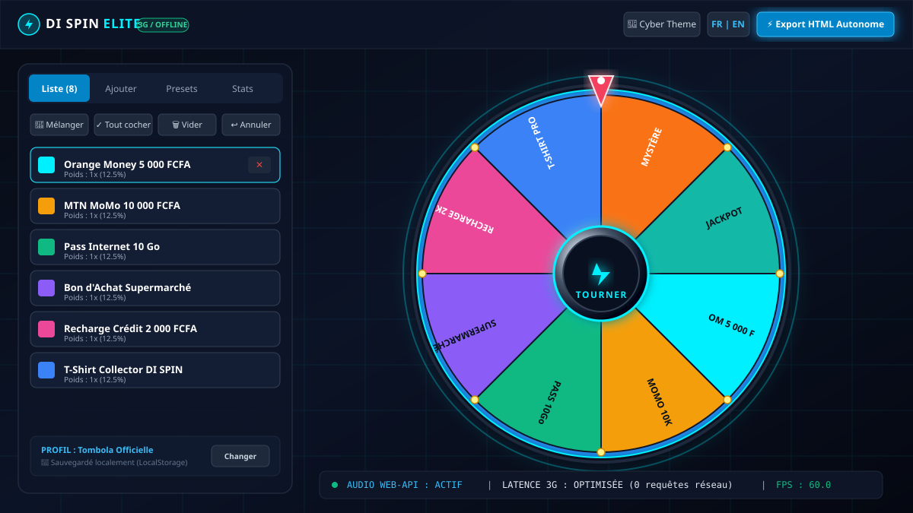
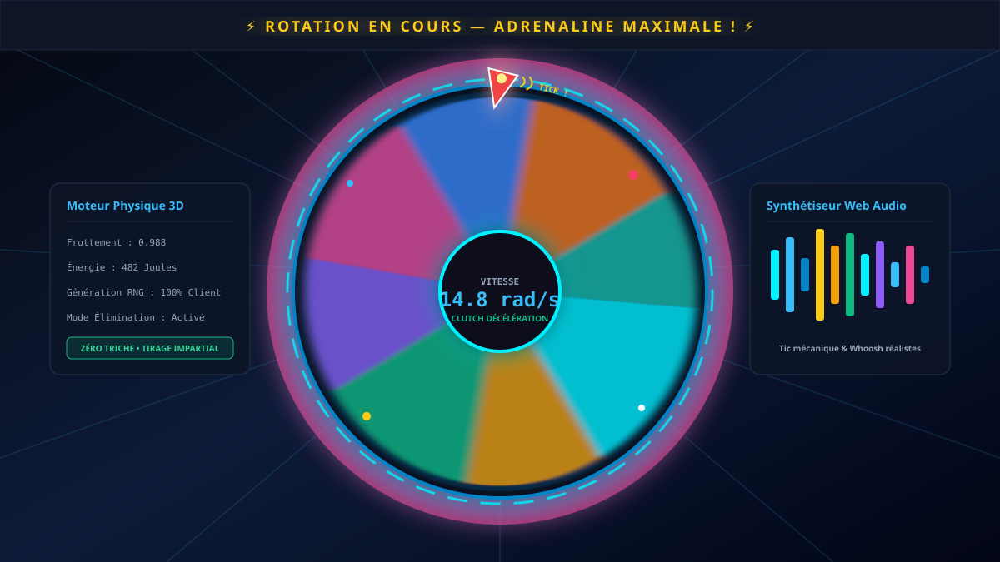

# ⚡ DI SPIN ELITE — Roue de Décision 3D & Tombola

> **La roue de décision 3D haute performance et impartiale, taillée pour les événements en direct, concours et tombolas, 100% fonctionnelle hors-ligne et optimisée pour réseaux 3G.**

---

[](LICENSE)
[](package.json)
[](https://react.dev/)
[](https://www.typescriptlang.org/)
[](https://vitejs.dev/)
[](https://tailwindcss.com/)
[](.github/workflows/deploy.yml)
[](https://[TON_PSEUDO].github.io/di-spin-elite/)

---

## 🌐 Démo en direct

👉 **Accéder à l'application en ligne :** [https://[TON_PSEUDO].github.io/di-spin-elite/](https://[TON_PSEUDO].github.io/di-spin-elite/)



---

## 📸 Aperçu & Captures d'écran

| 1. Interface & Gestionnaire | 2. Rotation 3D & Audio Synth | 3. Modale de Victoire & Confetti |
|:---:|:---:|:---:|
|  |  |  |
| *Configuration des tranches, poids, thèmes et profils* | *Moteur physique avec frottement et synthèse sonore Web Audio* | *Annonce du gagnant, effets de confettis et horodatage* |

> 💡 *Un script automatisé de capture Playwright est fourni dans `scripts/capture-screenshots.mjs` pour générer des PNGs haute résolution.*

---

## ✨ Fonctionnalités principales

- 🎡 **Rendu Canvas 3D & Moteur Physique Réaliste** : Double-buffer offscreen, cerclage métallique brossé, plots dorés 3D, ombre dynamique et aiguille à ressort avec déflexion progressive.
- 🔊 **Synthétiseur Audio Zéro-Dépendance (Web Audio API)** : Effets sonores temps réel générés par oscillateurs (quiosh de lancement, clics mécaniques synchronisés avec les plots, fanfare de victoire). Zéro fichier audio lourd à charger.
- 📦 **Export HTML Autonome (Single-File Vanilla)** : Téléchargez ou copiez l'intégralité du site en **un seul fichier HTML** ultra-léger, exécutable sur clé USB ou smartphone sans connexion internet.
- 🎯 **Équité & Tirage Impartial** : Moteur RNG 100% côté client, calcul d'angle déterministe avec courbe d'atténuation quintique (`ease-out`) et gestion fine des probabilités pondérées (poids de 1 à 10).
- 🇨🇲 **Expérience Bilingue & Culturelle** : Interface commutable Français / Anglais avec citations festives et presets adaptés (Orange Money, MTN MoMo, pass données, dotations).
- 🎨 **Personnalisation Étendue** : 6 thèmes d'effets (Cyber, Casino Gold, Neon Night, Sunset, Matrix, Emerald), mode élimination (retrait automatique du gagnant), mode photo-finish, et gestionnaire de profils avec sauvegarde `localStorage`.
- ⚡ **Performance Réseau 3G / Hors-Ligne** : Aucune dépendance externe bloquante au runtime, temps de chargement inférieur à 500 ms et fluidité constante à 60 FPS.

---

## 🛠️ Technologies utilisées

- **Frontend** : [React 19](https://react.dev/) + [TypeScript](https://www.typescriptlang.org/)
- **Build & Dev Server** : [Vite 6](https://vitejs.dev/)
- **Design & Styles** : [Tailwind CSS v4](https://tailwindcss.com/) + Icônes [Lucide React](https://lucide.dev/)
- **Moteur Graphique** : HTML5 Canvas 2D / 3D hardware-accelerated
- **Moteur Sonore** : Web Audio API (`AudioContext`, `OscillatorNode`, `GainNode`)
- **Animations** : [Motion](https://motion.dev/) & `requestAnimationFrame`
- **CI / CD** : GitHub Actions (`.github/workflows/deploy.yml`)

---

## 📋 Prérequis

- [Node.js](https://nodejs.org/) v18.0.0 ou supérieur (recommandé : v20 LTS ou v22)
- Gestionnaire de paquets [npm](https://www.npmjs.com/) (inclus avec Node.js), [pnpm](https://pnpm.io/) ou [bun](https://bun.sh/)
- Un navigateur moderne compatible Canvas et Web Audio API (Chrome, Safari, Firefox, Edge)

---

## 🚀 Installation et lancement local

Clonez le projet et lancez le serveur de développement en 3 commandes :

```bash
# 1. Cloner le dépôt
git clone https://github.com/[TON_PSEUDO]/di-spin-elite.git
cd di-spin-elite

# 2. Installer les dépendances
npm install

# 3. Démarrer le serveur de développement local
npm run dev
```

L'application est immédiatement accessible sur [http://localhost:3000](http://localhost:3000).

### Autres commandes utiles

```bash
# Compiler pour la production (génère le dossier /dist optimisé)
npm run build

# Prévisualiser la version de production localement
npm run preview

# Vérifier la cohérence TypeScript
npm run lint

# Générer les captures d'écran Playwright (optionnel)
node scripts/capture-screenshots.mjs
```

---

## ⚙️ Configuration (Variables d'environnement)

Pour un déploiement standard ou GitHub Pages, **aucune variable d'environnement obligatoire n'est requise** : l'application fonctionne de manière 100% autonome côté client.

Si vous utilisez des modules optionnels avec API (ex: proxy serveur Gemini), créez un fichier `.env` basé sur `.env.example` :

```bash
cp .env.example .env
```

Contenu de `.env.example` :
```env
# URL publique de déploiement (utilisée pour les liens absolus et métadonnées)
APP_URL="https://[TON_PSEUDO].github.io/di-spin-elite"

# Clé API serveur (optionnelle, jamais exposée côté client)
GEMINI_API_KEY=""
```

> ⚠️ **Sécurité** : Ne commitez jamais votre fichier `.env` avec de vraies clés. Le fichier `.gitignore` est déjà configuré pour ignorer tous les fichiers `.env*` sauf `.env.example`.

---

## 📂 Structure du projet

```text
di-spin-elite/
├── .github/
│   ├── ISSUE_TEMPLATE/
│   │   ├── bug_report.md          # Modèle de rapport d'anomalie
│   │   └── feature_request.md     # Modèle de suggestion de fonctionnalité
│   ├── workflows/
│   │   └── deploy.yml             # Pipeline GitHub Actions (Build & Déploiement Pages)
│   └── pull_request_template.md   # Modèle de contribution PR
├── docs/
│   └── screenshots/               # Visuels et captures d'écran de l'application
│       ├── 01-accueil.svg
│       ├── 02-roue-spin.svg
│       └── 03-victoire-modal.svg
├── scripts/
│   └── capture-screenshots.mjs    # Script Playwright de capture automatique
├── src/
│   ├── components/                # Composants d'interface (HUD, Roue, Modales, Panneau)
│   │   ├── ConfettiOverlay.tsx
│   │   ├── HistoryModal.tsx
│   │   ├── Panel.tsx
│   │   ├── SettingsModal.tsx
│   │   ├── StandaloneExportModal.tsx
│   │   ├── TopHud.tsx
│   │   ├── WheelArena.tsx
│   │   └── WinModal.tsx
│   ├── data/                      # Presets de tirage et configurations des thèmes
│   │   ├── presets.ts
│   │   └── themes.ts
│   ├── utils/                     # Synthétiseur Web Audio, export HTML et stockage local
│   │   ├── audio.ts
│   │   ├── exportStandaloneHtml.ts
│   │   └── storage.ts
│   ├── App.tsx                    # État global et orchestration de la roue
│   ├── index.css                  # Feuilles de style cyber & design tokens
│   ├── main.tsx                   # Point d'entrée React 19
│   └── types.ts                   # Définitions TypeScript
├── index.html                     # Document HTML principal & métadonnées
├── LICENSE                        # Licence open source MIT
├── package.json                   # Métadonnées, scripts et dépendances
├── README.md                      # Documentation officielle du projet
├── tsconfig.json                  # Configuration TypeScript
└── vite.config.ts                 # Configuration du bundler Vite (base './')
```

---

## 🚢 Déploiement

### Option 1 : Déploiement automatique sur GitHub Pages (Recommandé)

Le dépôt contient déjà le workflow `.github/workflows/deploy.yml`. À chaque `git push` sur la branche `main`, l'application est compilée et publiée automatiquement.

1. Rendez-vous sur votre dépôt GitHub : **Settings > Pages**.
2. Dans la section **Build and deployment > Source**, sélectionnez **GitHub Actions**.
3. Poussez votre code sur `main` : le site sera en ligne en moins d'une minute sur `https://[TON_PSEUDO].github.io/di-spin-elite/`.

### Option 2 : Déploiement sur Vercel ou Netlify

L'application étant une Single Page Application (SPA) statique et optimisée, elle se déploie sans aucune configuration complexe :

- **Vercel** : Importez le dépôt Git, laissez les valeurs par défaut (`Build Command: npm run build`, `Output Directory: dist`), puis cliquez sur **Deploy**.
- **Netlify** : Glissez-déposez le dossier `dist/` ou connectez votre dépôt avec la commande `npm run build` et le répertoire de publication `dist`.

---

## 🗺️ Feuille de route (Roadmap)

- [ ] **Mode Multijoueur P2P WebRTC** : Synchronisation en direct de la roue entre l'organisateur et les téléphones des participants sans serveur central.
- [ ] **Export Vidéo MP4 / GIF** : Enregistrement natif de la rotation et du tirage avec la Web Codecs API pour partage direct sur WhatsApp, TikTok et Instagram.
- [ ] **Import Direct Excel / CSV / Google Sheets** : Importation de listes de participants par simple glisser-déposer de fichier.
- [ ] **Personnalisation Audio Avancée** : Enregistrement de jingles vocaux personnalisés ou import de fichiers MP3 pour la sonnerie de victoire.

---

## 🤝 Contribution

Les contributions sont les bienvenues ! Pour contribuer :

1. **Forkez** le projet (`git fork`).
2. Créez votre branche de fonctionnalité :
   ```bash
   git checkout -b feat/ma-super-fonctionnalite
   ```
3. Commitez vos modifications selon la convention [Conventional Commits](https://www.conventionalcommits.org/) :
   ```bash
   git commit -m "feat: ajout de l'export CSV des gagnants"
   ```
4. Poussez votre branche :
   ```bash
   git push origin feat/ma-super-fonctionnalite
   ```
5. Ouvrez une **Pull Request** en complétant notre modèle de PR.

---

## 📄 Licence

Ce projet est distribué sous la licence libre **MIT**. Consultez le fichier [LICENSE](LICENSE) pour plus de détails.

---

## 👤 Auteur & Contact

- **Équipe de développement** : DI SPIN Team
- **Email de contact** : [dyasdyas237@gmail.com](mailto:dyasdyas237@gmail.com)
- **Signalement de bugs & suggestions** : [GitHub Issues](https://github.com/[TON_PSEUDO]/di-spin-elite/issues)
